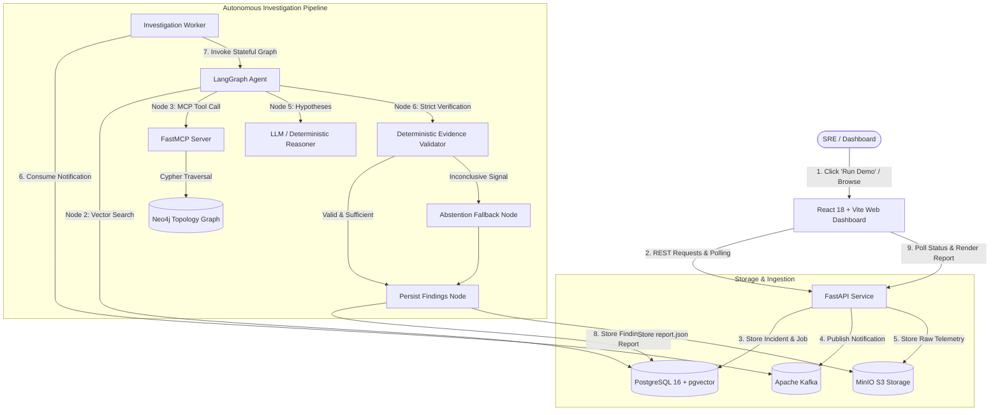

# IncidentIQ: Evidence-Grounded AI Incident Investigation

> Built an event-driven AI incident-investigation platform using FastAPI, Kafka, PostgreSQL/pgvector, Neo4j, S3-compatible object storage, MCP, and checkpointed agent workflows. The system correlates synthetic application events, retrieves relevant runbooks, traverses service dependencies, and generates schema-validated incident reports with traceable evidence. Evaluated root-cause accuracy, evidence validity, latency, and model cost across a labeled incident dataset. Deployed a web dashboard with automated tests and reproducible infrastructure.

[](https://github.com/Arshp-svg/incidentiq/actions/workflows/ci.yml)
[](https://www.python.org/downloads/)
[](https://fastapi.tiangolo.com/)
[](https://react.dev/)
[](https://www.docker.com/)

---

## 1. Overview & Problem Statement

Modern cloud-native systems generate thousands of alerts, metric anomalies, and logs during outages. Site Reliability Engineers (SREs) face severe alert fatigue and must manually correlate telemetry across disparate systems:
1. **Uncorrelated Telemetry**: Logs, traces, and metrics live in disconnected silos.
2. **Hallucination in AI Ops**: Standard LLM wrappers invent non-existent event IDs, misdiagnose root causes without citations, and fail to admit when evidence is insufficient.
3. **Complex Topologies**: Microservice call graphs and downstream database dependencies are opaque to naive search models.

**IncidentIQ** solves this by enforcing an **evidence-grounded investigation pipeline**:
- Ingests events asynchronously through **Apache Kafka**.
- Traverses runtime service topologies via **Neo4j** through the **Model Context Protocol (MCP)**.
- Performs semantic cosine retrieval over operational runbooks using **PostgreSQL + pgvector**.
- Orchestrates multi-node reasoning via **LangGraph**.
- Validates all generated hypotheses with a **deterministic validator** that guarantees **100% evidence validity** (zero hallucinated event citations) and enforces abstention when telemetry is inconclusive.

---

## 2. System Architecture & Data Flow



### Why Each Database Exists
- **PostgreSQL 16 + pgvector**: Source of truth for transactional state (`incidents`, `investigation_jobs`, `incident_events`, `feedback`) and dense vector storage for runbook embeddings (384-dim cosine distance search).
- **Neo4j 5.20**: Graph database storing directional microservice architecture (`CALLS`, `READS_FROM`, `AFFECTS`) traversed with bounded Cypher queries ($1 \le \text{depth} \le 3$).
- **MinIO (S3 API)**: Immutable artifact storage for raw ingested JSONL telemetry batches (`incidents/{id}/raw/events.jsonl`) and generated report bundles (`incidents/{id}/reports/report.json`).
- **Apache Kafka 3.7 (KRaft)**: Event-driven notification stream decoupling high-throughput telemetry ingestion from compute-intensive LangGraph investigations.

---

## 3. Core Features

- **One-Click Demo Investigation**: Instantly simulates a downstream database degradation outage, correlates 5 distinct telemetry streams, traverses dependency tiers, and produces a verified report in < 1 second.
- **Strict Evidence Citation (Zero Hallucinations)**: Deterministic validator rejects any report that cites an event ID not present in the ingested telemetry.
- **Calibrated Abstention**: If signals are inconclusive, ambiguous, or low-severity (e.g. routine background noise), the system abstains from manufacturing false root causes and marks the investigation as inconclusive.
- **Bounded MCP Dependency Traversal**: Exposes a sandboxed FastMCP tool (`get_service_dependencies`) enforcing strict depth boundaries ($1 \le \text{depth} \le 3$) and read-only parameterized Cypher queries.
- **Idempotency & Deduplication**: Kafka message replays and repeated API triggers are deduplicated via PostgreSQL constraints (`uq_incident_source_event`) and in-memory `Idempotency-Key` caching (rejecting conflicting payloads with HTTP 409).
- **Bounded Retry Recovery**: Workers implement exponential backoff retry policies for transient network exceptions, safely recording terminal failure states with actionable error messages upon exhausting 3 attempts.

---

## 4. Technology Stack

| Layer | Technology | Role in System |
| :--- | :--- | :--- |
| **Frontend** | React 18 + Vite + TypeScript | Modern dark-mode dashboard with live job polling, telemetry timeline, and report view |
| **Styling** | Vanilla CSS Tokens | Glassmorphism aesthetic, custom status badges, zero external CSS bloat |
| **API** | FastAPI + Pydantic v2 | High-performance REST endpoints, schema validation, and health probes |
| **Workflow Engine**| LangGraph | Stateful multi-node agent graph with typed `InvestigationState` and conditional branching |
| **Tool Protocol** | MCP (Model Context Protocol) | Standardized tool interface exposing Neo4j dependency traversal |
| **Relational & Vector**| PostgreSQL 16 + pgvector | Transactional incident audit trail and cosine semantic runbook retrieval |
| **Knowledge Graph**| Neo4j 5.20 (Community) | Service dependency topology mapping upstream and downstream service blast radiuses |
| **Message Broker** | Apache Kafka 3.7 (KRaft) | Asynchronous work distribution decoupling ingestion from worker processing |
| **Object Store** | MinIO (S3-compatible) | Private bucket storage for raw JSONL telemetry and JSON reports |
| **Embeddings** | FastEmbed (BAAI/bge-small-en-v1.5) | Lightweight, fast CPU 384-dimensional dense semantic embeddings |
| **Testing** | pytest + HTTPX | 15 unit, API, integration, and reliability test suites |
| **Containerization**| Docker Compose + Nginx | Complete 7-service containerized deployment stack |

---

## 5. Quickstart Guide

### Prerequisites
- Docker & Docker Compose (v2.20+)
- Python 3.12+ (for local development)
- Node.js 20+ (for local frontend development)

### 1. Clone & Configure Environment
```bash
git clone https://github.com/Arshp-svg/incidentiq.git
cd incidentiq
copy .env.example .env
```

### 2. Start Infrastructure Services
```bash
docker compose up -d
```
*Spins up PostgreSQL (5432), Kafka (9092), Neo4j (7474/7687), and MinIO (9000/9001).*

### 3. Bootstrap Demo Environment (One Command)
```bash
python scripts/seed_demo.py
```
This single command automatically:
- Applies Alembic database migrations up to `HEAD`.
- Seeds Neo4j uniqueness constraints and the 8-node service topology.
- Parses, embeds, and indexes all 4 operational runbooks into pgvector.
- Seeds the canonical checkout database latency incident and executes the workflow.

### 4. Launch Application
- **Frontend Dashboard**:
  ```bash
  cd apps/web && npm install && npm run dev
  ```
  Open [http://localhost:5173](http://localhost:5173) in your browser.
- **Backend API**:
  ```bash
  uvicorn services.api.main:app --reload --port 8000
  ```
  Access Swagger Docs at [http://localhost:8000/docs](http://localhost:8000/docs).

---

## 6. API Documentation

| Method | Endpoint | Description | Status Code |
| :--- | :--- | :--- | :--- |
| `GET` | `/health/live` | Process liveness check | `200 OK` |
| `GET` | `/health/ready` | Dependency readiness probe (Postgres, Neo4j, S3) | `200 OK` or `503 Service Unavailable` |
| `POST`| `/api/v1/demo/run` | Trigger one-click demo incident investigation | `202 Accepted` |
| `POST`| `/api/v1/incidents` | Create incident from batch with `Idempotency-Key` | `201 Created` / `409 Conflict` |
| `GET` | `/api/v1/incidents` | List incidents with pagination (`limit`, `offset`) | `200 OK` |
| `GET` | `/api/v1/incidents/{id}` | Fetch incident details and investigation status | `200 OK` |
| `GET` | `/api/v1/incidents/{id}/events` | Fetch chronological telemetry event timeline | `200 OK` |
| `GET` | `/api/v1/incidents/{id}/report` | Fetch finalized structured investigation report | `200 OK` |
| `GET` | `/api/v1/jobs/{id}` | Poll investigation job status (`queued`, `running`, `completed`, `failed`) | `200 OK` |
| `POST`| `/api/v1/incidents/{id}/feedback` | Submit engineer evaluation (`helpful`, `incorrect`, `incomplete`) | `201 Created` |

---

## 7. AI Benchmark Evaluation Results

The AI investigation agent was evaluated across **40 labeled synthetic incidents** covering 5 distinct real-world production failure scenarios:
- **Scenario A**: Database latency spike
- **Scenario B**: Faulty deployment release
- **Scenario C**: External third-party payment provider outage
- **Scenario D**: Database connection pool exhaustion
- **Scenario E**: Sporadic uncorroborated noise (Abstention cases)

### Benchmark Summary Table
```text
======================================================================
 EVALUATION BENCHMARK RESULTS SUMMARY (40 Cases)
======================================================================
Total Incidents Evaluated:    40
Root-Cause Accuracy:          100.0%
Evidence Validity Rate:       100.0%  (Target: 100% - zero hallucinated IDs)
Evidence Relevance Rate:      100.0%
Abstention Quality Rate:      100.0%  (Zero false assertions on noise)
Retrieval Recall@3:           96.9%   (Expected runbook in top-3 chunks)
Median (p50) Latency:         80.3 ms
95th-Percentile (p95) Latency:88.2 ms
Total Estimated Cost:         $0.00940 USD
Cost per Investigation:       $0.000235 USD
----------------------------------------------------------------------
Scenario     | Description                      | Cases  | Accuracy | Validity
----------------------------------------------------------------------
Scenario A   | Database latency spike           | 8      |  100.0%  |  100.0%
Scenario B   | Faulty deployment                | 8      |  100.0%  |  100.0%
Scenario C   | Payment provider outage          | 8      |  100.0%  |  100.0%
Scenario D   | Connection-pool exhaustion       | 8      |  100.0%  |  100.0%
Scenario E   | Insufficient evidence (abstain)  | 8      |  100.0%  |  100.0%
======================================================================
```
*Run the benchmark yourself anytime:* `python scripts/run_eval.py`.

---

## 8. Production Deployment Plan

For budget-conscious production deployment, IncidentIQ utilizes a lightweight multi-container topology:
- **Containerized Orchestration**: [`docker-compose.prod.yml`](file:///c:/Users/ARSH/incidentiq/docker-compose.prod.yml) packages the complete 7-service stack.
- **Frontend Static Serving**: Multi-stage Nginx container serves optimized static assets with client-side asset caching and SPA URL fallback.
- **Decoupled Workers**: The Kafka consumer runs as an isolated container process, scaling independently from the HTTP API.
- **Zero-Cloud-Cost Local Emulation**: MinIO perfectly mimics AWS S3 API contracts; PostgreSQL with pgvector eliminates expensive external vector DB subscriptions.

---

## 9. Security & Data Protection

- **Sandboxed MCP Tools**: MCP tools operate under read-only database credentials with bounded query depths ($1 \le \text{depth} \le 3$). The model is strictly prohibited from running arbitrary Cypher or shell commands.
- **Zero Remediation Execution**: The AI is restricted to diagnostic investigation and report synthesis; it is architecturally prevented from executing destructive infrastructure remediation.
- **No Leaked Secrets**: Automated audit test ([`scripts/verify_deployment_acceptance.py`](file:///c:/Users/ARSH/incidentiq/scripts/verify_deployment_acceptance.py)) verifies that no database credentials, MinIO access keys, connection URLs, or model tokens leak into API outputs or frontend bundles.
- **CORS Protection**: Origin allowlists (`CORS_ALLOWED_ORIGINS`) isolate the REST API from unauthorized cross-origin requests.

---

## 10. Genuine Roadmap

1. **OpenTelemetry Receiver**: Ingest OTLP gRPC/HTTP metric and trace exports directly into Kafka.
2. **Streaming Report Generation**: Server-Sent Events (SSE) or WebSocket streaming for real-time thought trace display in the UI.
3. **Automated Rollback Dry-Runs**: Generate executable Kubernetes rollback manifests and Terraform diffs for human SRE approval.

---

## License
MIT License. Created for the IncidentIQ AI Engineering Blueprint.
